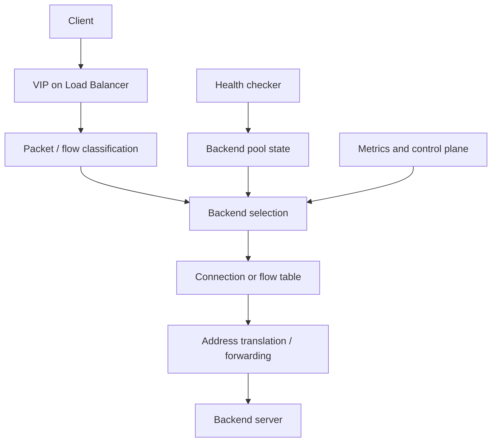

# Layer 4 Load Balancer

**Category:** HLD / Networking  
**Status:** Initial conceptual design

## 1. Problem statement

Design a Layer 4 load balancer that distributes TCP and UDP connections across a pool of backend servers while checking backend health and preserving flow consistency.

## 2. Requirements

### Functional
- Accept client traffic on a virtual IP and port.
- Select a healthy backend.
- Support configurable algorithms.
- Track connection / flow mappings where required.
- Detect unhealthy backends and stop assigning new flows to them.
- Expose health and traffic metrics.

### Non-functional
- High throughput and low latency.
- No single overloaded backend.
- Predictable failover behavior.
- Horizontal scalability.
- Secure management and configuration.

## 3. Architecture

## 4. Backend selection algorithms

- Round robin: simple rotation across eligible backends.
- Weighted round robin: accounts for configured capacity.
- Least connections: selects a backend with fewer active connections.
- Consistent hashing: helps keep a client or flow mapped consistently as pool membership changes.

Algorithm choice depends on protocol, workload, backend capacity, and whether session persistence is required.

## 5. Flow handling

For each new flow:
1. Parse the transport tuple.
2. Select a healthy backend.
3. Create a forward / reverse mapping if the forwarding mode requires it.
4. Forward packets consistently to that backend.
5. Expire state according to protocol-specific timeouts.

For TCP, connection state and retransmission behavior matter. For UDP, idle timeout and flow affinity must be explicitly defined.

## 6. Forwarding modes

- NAT-based: rewrite addresses / ports and maintain reverse mapping.
- Direct server return: backend replies directly to client; requires routing and address configuration.
- Full proxy: terminate client and backend connections separately; provides more control but uses more resources.

## 7. Health checking

Use configurable active probes and, where useful, passive failure signals. Define thresholds for marking a backend unhealthy and healthy again to avoid flapping. Health-check traffic should not be confused with user traffic.

## 8. Scaling and availability

- Use multiple load-balancer instances behind routing or an upstream distribution mechanism.
- Define VIP ownership and failover.
- Decide whether flow state is replicated, synchronized, or rebuilt after failover.
- Avoid a shared control-plane dependency on every packet.
- Monitor CPU, queue depth, connection count, backend latency, and drops.

## 9. Failure scenarios

| Scenario | Handling |
|---|---|
| Backend fails | Stop new assignments; handle existing flows by defined policy |
| Health-check false positive | Use thresholds and recovery delay |
| Load balancer fails | Fail over VIP / route to another instance |
| Backend pool empty | Return configured failure behavior |
| State table full | Reject or shed new flows safely |

## 10. Security

- Validate packets and protocol state.
- Restrict management access.
- Protect health-check endpoints.
- Apply connection and rate limits.
- Prevent spoofed client metadata in proxy modes.

## 11. Validation

Test distribution fairness, backend removal and re-entry, connection persistence, asymmetric routing, failover, burst traffic, and large numbers of concurrent flows. Record throughput, latency, drops, and resource usage.

## 12. Interview questions

1. Compare L4 and L7 load balancing.
2. When would you use consistent hashing?
3. How does Direct Server Return work?
4. What happens to existing TCP connections when a backend fails?
5. How do you avoid a load balancer becoming a bottleneck?

## 13. Summary

A Layer 4 load balancer is a flow-distribution and availability system. Backend selection is only one part; flow consistency, health detection, forwarding mode, and failover define the overall design.