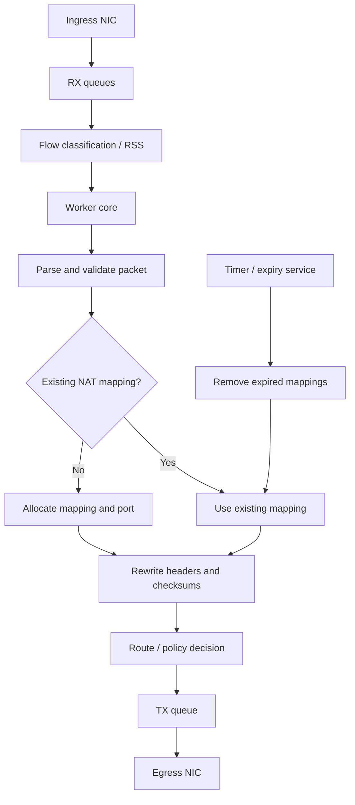

# High-Performance NAT Gateway

**Category:** Networking / HLD  
**Focus:** IPv4 source NAT, session tracking, multi-core packet processing  
**Status:** Initial conceptual design; not benchmarked

## 1. Problem statement

Design a NAT gateway that translates private IPv4 traffic to public IPv4 addresses and tracks mappings so return traffic can be translated back to the correct internal endpoint.

Illustrative engineering targets:
- Up to 1 million concurrent NAT mappings.
- A target throughput of 10 million packets per second (10 Mpps).
- TCP, UDP, and ICMP handling.
- Multiple CPU cores and NIC queues.

These are requirements to validate, not claimed performance results.

## 2. Functional requirements

- Create and look up NAT mappings.
- Translate outbound source addresses and transport ports.
- Translate inbound destination addresses and ports using reverse mappings.
- Handle TCP, UDP, and ICMP identifiers appropriately.
- Expire idle state and reclaim resources.
- Apply configured address and port pools.
- Expose counters, logs, and operational state.

## 3. Non-functional requirements

- Predictable packet latency and high throughput.
- Correctness under concurrent traffic.
- Bounded memory use and controlled table exhaustion.
- Resilience to malformed packets and resource exhaustion.
- Observability without excessive per-packet logging.

## 4. Assumptions and capacity thinking

For one million active mappings, estimate memory from the actual data structure rather than assuming the session structure alone is the full cost.

```text
Total memory ≈ entries × (entry size + hash-table overhead)
             + timers + allocator overhead + counters
```

For 10 Mpps, average packet-processing budget depends on the number of usable CPU cores and clock rate. Benchmark with representative packet sizes and traffic mixes; small packets often stress packet-per-second capacity more than bandwidth.

## 5. High-level architecture



A production design must also show the reverse direction: inbound packets are looked up using the public-side tuple and translated to the private-side tuple.

## 6. NAT mapping model

A conceptual mapping contains:
- Protocol.
- Inside (private) IPv4 address and port / identifier.
- Outside (public) IPv4 address and allocated port.
- Remote endpoint information when endpoint-dependent mapping/filtering is required.
- State and last-activity timestamp.
- Timeout policy and ownership / worker information.

Example C++ model (illustrative; production layout should consider alignment, byte order, and memory footprint):

```cpp
#include <cstdint>

struct NatSession {
    std::uint32_t inside_ip;
    std::uint32_t outside_ip;
    std::uint16_t inside_port;
    std::uint16_t outside_port;
    std::uint8_t protocol;
    std::uint64_t last_seen_seconds;
};
```

The key must match the NAT behavior being implemented. A simple inside-address/port key is not sufficient for every endpoint-dependent NAT design.

## 7. Packet processing path

1. Receive a burst from an RX queue.
2. Parse Ethernet and IPv4 headers; validate lengths and fragmentation behavior.
3. Identify protocol and flow tuple.
4. Find or create the correct mapping.
5. Rewrite the relevant IP address and transport port / ICMP identifier.
6. Recompute or incrementally update checksums correctly.
7. Apply routing, ACL, and MTU decisions.
8. Enqueue the packet for transmission.
9. Update per-core counters.

Fragments require explicit handling because non-initial IP fragments do not contain TCP/UDP ports. The design must define fragment association and timeout behavior.

## 8. Multi-core strategy

A practical starting point is flow affinity:
- Use RSS or software flow hashing to steer packets for a flow consistently.
- Assign RX/TX queues to worker cores.
- Prefer per-worker state to reduce shared locks.
- Define how reverse-direction packets reach the worker that owns the mapping.
- If state is shared, define synchronization and memory reclamation carefully.

Per-worker tables reduce contention but need an explicit strategy for bidirectional flow affinity and failover. Avoid claiming that simply assigning one queue per core solves every state-sharing problem.

## 9. Failure and overload handling

| Scenario | Required behavior |
|---|---|
| Port pool exhausted | Reject new mapping safely; increment counter |
| Session table full | Apply configured admission policy |
| Malformed packet | Drop safely; count reason |
| Worker overloaded | Monitor queue depth and drops; define backpressure policy |
| NIC / link failure | Trigger route or redundancy handling |
| Expiry service delayed | Bound stale-state growth and monitor timer lag |

## 10. Security and observability

- Validate packet lengths before accessing headers.
- Defend against malformed fragments and resource-exhaustion attacks.
- Enforce configured address / port ranges.
- Export mapping counts, allocation failures, drops, queue occupancy, and per-core utilization.
- Rate-limit logs; use counters for hot-path visibility.

## 11. Validation plan

Test correctness before performance:
- TCP and UDP outbound and return traffic.
- Port collision and allocation exhaustion.
- Mapping expiry and reuse.
- Fragmented traffic and malformed headers.
- Multiple workers processing bidirectional traffic.
- Failover and restart behavior.

For performance, record CPU model, NIC, driver, queue count, core pinning, packet sizes, traffic mix, offered load, achieved Mpps, latency percentiles, and packet drops.

## 12. Trade-offs and open questions

- Endpoint-independent versus endpoint-dependent mapping.
- Per-worker tables versus shared table.
- Software checksum update versus NIC offload.
- Timer wheel versus periodic expiry scan.
- Stateful failover versus session re-establishment.

## 13. Interview discussion

1. How would you preserve flow affinity in both directions?
2. How do you handle non-initial IP fragments?
3. What is the memory cost of one million sessions?
4. How do you avoid port collisions?
5. What limits small-packet Mpps?
6. How would you benchmark and prove a 10 Mpps target?

## 14. Summary

The core design challenge is not only rewriting packet headers. It is maintaining correct bidirectional state while distributing packets across CPU cores, bounding memory and handling failure and overload safely.