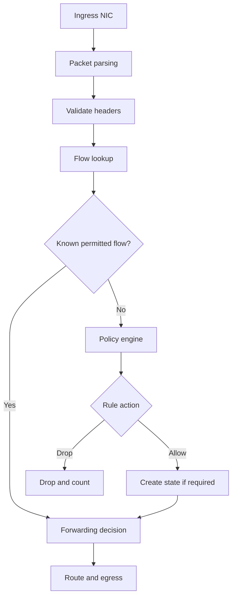

# Stateful Network Firewall

**Category:** Networking / HLD  
**Status:** Initial conceptual design

## 1. Problem statement

Design a stateful firewall that inspects packets, evaluates security policy, tracks permitted flows, and forwards or drops traffic.

## 2. Requirements

### Functional
- Support ingress and egress filtering.
- Match rules using source/destination IP, protocol, and ports.
- Support ordered policy rules and a default action.
- Track connection state for TCP and suitable UDP / ICMP flows.
- Support rule updates and counters.

### Non-functional
- Low latency and high packet throughput.
- Predictable rule evaluation.
- Safe configuration updates.
- Bounded state-table memory.
- Useful audit and operational metrics.

## 3. Architecture

## 4. Packet decision sequence

1. Validate packet and parse the required headers.
2. Build a normalized flow key.
3. Check existing connection state.
4. For a new flow, evaluate policy rules in the configured order.
5. Apply allow, drop, reject, or other supported action.
6. Create state only when the policy and protocol semantics require it.
7. Forward the packet and update counters.

A production firewall must define behavior for fragments, ICMP errors, TCP state transitions, asymmetric routing, and invalid state.

## 5. Core data models

A rule may contain:
- Rule identifier and priority.
- Source and destination prefixes.
- Protocol and optional port ranges.
- Direction / interface / zone.
- Action and logging configuration.

A flow-state entry may contain:
- Forward and reverse tuple keys.
- Protocol state and timeout.
- Rule identifier that permitted the flow.
- Last-seen timestamp and counters.

## 6. Rule lookup choices

- Linear scan: simple, suitable for small rule sets.
- Prefix trees: useful for IP-prefix matching.
- Hash tables: efficient for exact flow-state lookup.
- Tuple-space or compiled decision structures: possible for larger rule sets.

The best structure depends on rule count, match dimensions, update frequency, and traffic distribution.

## 7. Concurrency and updates

- Keep packet-path reads efficient.
- Build a new immutable policy snapshot and switch readers to it atomically, or use a carefully designed read-copy-update strategy.
- Define memory reclamation so old policy data is not freed while a worker still reads it.
- Keep counters per core where practical and aggregate them outside the hot path.

## 8. Failure cases

| Failure | Consideration |
|---|---|
| Policy load fails | Keep last known-good policy |
| State table full | Apply explicit fail-closed / configured behavior |
| Asymmetric traffic | Define state synchronization or routing constraints |
| Worker crash | Define state ownership and recovery |
| Malformed packet | Drop safely and count |
| Logging overload | Rate-limit and avoid blocking packet path |

## 9. Security and observability

- Default-deny policy where appropriate.
- Validate configuration and rule ordering.
- Protect management APIs and audit policy changes.
- Track allowed / dropped packets by reason, rule, interface, and protocol.
- Avoid logging sensitive payloads by default.

## 10. Validation

Test rule precedence, overlapping prefixes, port ranges, established and invalid flows, fragments, ICMP errors, policy replacement under load, and state expiry. Benchmark with realistic rules and traffic; report hardware and test methodology.

## 11. Interview questions

1. How does a stateful firewall differ from a stateless ACL?
2. How would you make policy updates safe for worker threads?
3. How do you handle asymmetric routing?
4. Which data structure would you choose for 100,000 rules, and why?
5. What is the correct behavior when the state table is full?

## 12. Summary

A firewall combines fast packet classification with correct state tracking and safe policy management. The most important design decisions are rule lookup, state ownership, update consistency, and failure behavior.