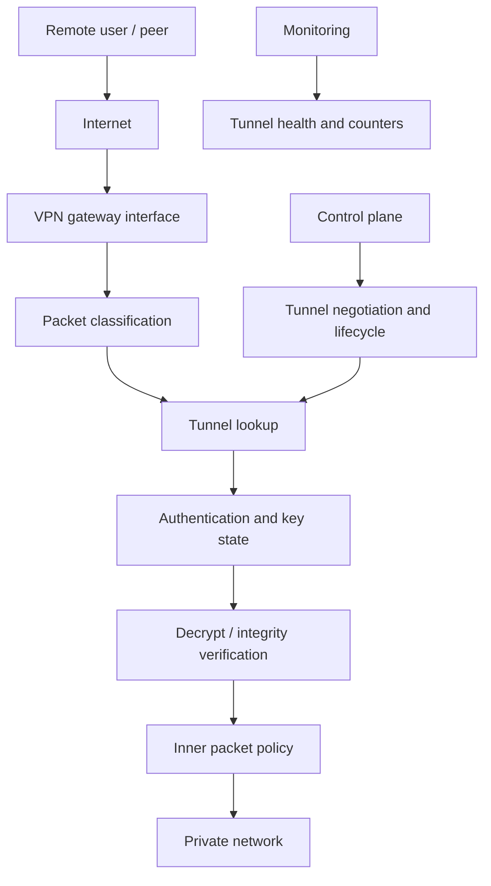

# VPN Gateway Architecture

**Category:** Networking / HLD  
**Scope:** IPsec and SSL/TLS VPN concepts  
**Status:** Initial conceptual design

## 1. Problem statement

Design a VPN gateway that securely connects remote users or remote networks to protected private resources over an untrusted IP network.

## 2. Functional requirements

- Authenticate users or peers.
- Negotiate secure tunnel parameters.
- Establish, maintain, and tear down tunnels.
- Encrypt outbound traffic and decrypt inbound traffic.
- Apply routing and access-control policy.
- Track tunnel status, byte counters, and errors.
- Support rekeying and peer liveness detection.

## 3. Non-functional requirements

- Confidentiality, integrity, and peer authentication.
- High availability and predictable recovery.
- Scalable tunnel and session management.
- Safe key handling.
- Operational observability.

## 4. High-level architecture

## 5. Main components

### Control plane
- Peer configuration and authentication.
- IKE / TLS negotiation as applicable.
- Key lifecycle, rekeying, and tunnel state.
- Route and policy installation.

### Data plane
- Identify the tunnel for an incoming packet.
- Verify integrity and decrypt.
- Validate the inner packet against policy.
- Route the inner packet.
- Encrypt and encapsulate outbound packets.

### Management and monitoring
- Provision peers and certificates.
- Report tunnel state, traffic counters, and failures.
- Audit configuration and authentication events.

## 6. IPsec concepts

An IPsec site-to-site or remote-access design commonly uses IKE to authenticate peers and negotiate Security Associations. ESP provides packet protection. The design must specify:
- IKE version and authentication method.
- Encryption and integrity algorithms consistent with current security policy.
- Traffic selectors.
- Rekey and lifetime behavior.
- NAT traversal requirements.
- Replay protection and anti-replay window behavior.

Avoid hard-coding obsolete algorithms; use current organizational cryptographic policy.

## 7. SSL/TLS VPN concepts

A TLS-based remote-access VPN typically establishes an authenticated TLS connection and then provides a protected path for selected client traffic. Define:
- User authentication and optional MFA.
- Certificate validation and trust model.
- Split-tunnel versus full-tunnel behavior.
- Address allocation and DNS policy.
- Per-user access controls and session expiry.

## 8. Scaling and performance

- Separate control-plane tunnel negotiation from packet forwarding.
- Use efficient packet batching and crypto acceleration where available.
- Consider CPU affinity and queue assignment.
- Measure encryption cost, packet size, tunnel count, and rekey bursts.
- Define limits for concurrent tunnels and per-user throughput.

## 9. Failure scenarios

| Scenario | Handling |
|---|---|
| Peer unreachable | Liveness detection and tunnel timeout |
| Rekey failure | Retry policy and controlled tunnel recovery |
| Certificate expired | Reject authentication and alert |
| Key mismatch | Fail closed and record diagnostic reason |
| Gateway failure | HA takeover with explicitly defined state behavior |
| MTU / fragmentation issue | Path-MTU handling and appropriate MSS adjustment |

## 10. Security considerations

- Protect private keys and secrets.
- Validate certificates and peer identity.
- Enforce least-privilege routes and policies.
- Prevent downgrade to weak cryptographic settings.
- Rate-limit authentication attempts.
- Audit administrative changes.
- Avoid logging secrets or decrypted payloads.

## 11. Validation plan

Test successful and failed authentication, rekey, peer restart, packet replay, NAT traversal, MTU edge cases, split-tunnel policy, route changes, failover, and concurrent tunnel load.

## 12. Interview questions

1. What is the difference between IKE and ESP?
2. What is a Security Association?
3. How does NAT traversal work in IPsec?
4. What is the difference between site-to-site and remote-access VPN?
5. How do split tunneling and full tunneling differ?
6. What state must be synchronized for VPN high availability?

## 13. Summary

A VPN gateway has a security-sensitive control plane and a performance-sensitive data plane. Correct identity verification, key lifecycle, packet protection, routing policy, and failure handling are all essential to a reliable design.